# Global Sequence Diagram

This Mermaid source mirrors the current implementation flow in the extension codebase. It documents the startup, authentication, auto-load, CRUD, generation, AI validation, and RAG agent paths without changing application logic.

```mermaid
sequenceDiagram
    autonumber

    actor User
    participant VSCode as VS Code
    participant Workspace as Workspace / MTF.yaml
    participant State as workspaceState
    participant Auto as autoLoadState

    box Extension Host
        participant Ext as extension.ts
        participant Panel as WebviewProvider
        participant Handler as MessageHandler
        participant Token as TokenStorage
        participant Auth as AuthService
        participant Store as StorageService
        participant DB as DB Layer
        participant Chan as ChannelManager
        participant Map as MappingManager
        participant Gen as ConfigGenerator
        participant CfgVal as ConfigValidator
        participant AI as AIValidator
        participant Local as LocalValidator
        participant KB as KnowledgeBase
        participant Agent as MtfAgent
        participant Ollama as OllamaClient
        participant Gemini as Gemini API
    end

    box Webview
        participant UI as React Webview
    end

    rect rgb(27, 35, 57)
        Note over VSCode, UI: Startup and panel bootstrap
        VSCode->>Ext: activate(context)
        Ext->>VSCode: testDatabaseConnection()
        Ext->>Store: new StorageService(context)
        Ext->>Workspace: findFiles("**/MTF.yaml")
        alt MTF.yaml already exists
            Ext->>State: get("mtfConfigId")
            alt stored config id found and config exists
                Ext->>Store: getConfigurationById(storedId)
                Store-->>Ext: existing config
                Ext->>Auto: setAutoLoad(existing)
            else no stored config or config missing
                Ext->>Workspace: readFile(MTF.yaml)
                alt file is empty
                    Ext->>Workspace: writeFile(DEFAULT_MTF_YAML)
                end
                Ext->>State: update("mtfConfigId", newId)
                Ext->>Auto: setAutoLoad(empty config)
            end
            Ext->>Panel: open(extensionUri, context)
            Panel->>Handler: new MessageHandler(...)
            Panel->>UI: load webview HTML
        end
        Ext->>VSCode: createFileSystemWatcher("**/MTF.yaml")
        Ext->>VSCode: register open/import/export commands

        opt MTF.yaml is created later while extension is running
            VSCode-->>Ext: onDidCreate(MTF.yaml)
            Ext->>Workspace: readFile(MTF.yaml)
            alt new file is empty
                Ext->>Workspace: writeFile(DEFAULT_MTF_YAML)
            end
            Ext->>State: update("mtfConfigId", newId)
            Ext->>Auto: setAutoLoad(empty config)
            alt panel already exists
                Ext->>Panel: applyPendingLoad()
                Panel->>Handler: applyAutoLoad(webview)
            else panel not open
                Ext->>Panel: open(extensionUri, context)
            end
        end
    end

    rect rgb(24, 62, 66)
        Note over User, UI: Authentication and initial configuration sync
        UI->>Handler: checkAuth
        Handler->>Token: getAuthToken()
        alt no token stored
            Handler-->>UI: authRequired
        else token exists
            Handler->>Auth: verifyToken(token)
            alt token invalid
                Handler->>Token: clearAuthToken()
                Handler-->>UI: authRequired
            else token valid
                Auth-->>Handler: user payload
                Handler->>Store: purgeOrphanedConfigs()
                Handler-->>UI: authSuccess(token, user)
                UI->>Handler: getConfigurations
                Handler->>Store: getAllConfigurations()
                Store-->>Handler: stored configs
                Handler-->>UI: configurationsLoaded(mine)
                Handler->>Auto: consumeAutoLoad()
                alt pending auto-load exists
                    Auto-->>Handler: pending config
                    Handler->>Store: saveRaw(raw)
                    Handler->>DB: saveConfigurationToDb(...)
                    Handler->>Chan: new ChannelManager()
                    Handler->>Map: new MappingManager(channelManager)
                    Handler-->>UI: configurationsLoaded(updated mine)
                    Handler-->>UI: configurationLoaded(raw)
                end
            end
        end
    end

    rect rgb(53, 33, 50)
        Note over User, DB: Configuration editing lifecycle
        User->>UI: Create configuration
        UI->>Handler: createConfiguration(name)
        Handler->>Store: saveConfiguration(currentConfig)
        Handler->>DB: saveConfigurationToDb(...)
        Handler-->>UI: configurationCreated

        User->>UI: Add logical channel
        UI->>Handler: addLogicalChannel(channel)
        Handler->>Chan: addLogicalChannel(channel)
        Handler->>Store: saveConfiguration(currentConfig)
        Handler->>DB: saveConfigurationToDb(...)
        Handler-->>UI: success(addLogicalChannel)

        User->>UI: Add hardware channel
        UI->>Handler: addHardwareChannel(channel)
        Handler->>Chan: addHardwareChannel(channel)
        Handler->>Store: saveConfiguration(currentConfig)
        Handler->>DB: saveConfigurationToDb(...)
        Handler-->>UI: success(addHardwareChannel)

        User->>UI: Create mapping
        UI->>Handler: addMapping(logicalId, hardwareId, params)
        Handler->>Map: addMapping(...)
        Map->>Chan: getLogicalChannel(logicalId)
        Map->>Chan: getHardwareChannel(hardwareId)
        Map->>Map: validateCompatibility + duplicate checks
        Map->>Chan: registerMappingForChannel(...)
        Handler->>Store: saveConfiguration(currentConfig)
        Handler->>DB: saveConfigurationToDb(...)
        Handler-->>UI: success(addMapping)
    end

    rect rgb(74, 62, 21)
        Note over User, Workspace: YAML generation
        User->>UI: Generate config
        UI->>Handler: generateConfig(frameworkData?)
        opt framework data provided
            Handler->>Handler: _applyFrameworkData(...)
            Handler->>Store: saveConfiguration(currentConfig)
            Handler->>DB: saveConfigurationToDb(...)
        end
        Handler->>Gen: generate()
        Gen->>CfgVal: validate(config, mappingManager)
        CfgVal-->>Gen: errors[]
        alt validation errors exist
            Gen-->>Handler: throw Error
            Handler-->>UI: error(message)
        else configuration is valid
            Gen->>Map: getMappingsByConfigId(config.id)
            Gen-->>Handler: yamlContent
            Handler-->>UI: configGenerated(yaml)
            Handler->>Workspace: writeFile(MTF.yaml, yamlContent)
        end
    end

    rect rgb(31, 55, 48)
        Note over User, Gemini: AI validation
        User->>UI: Run AI validation
        UI->>Handler: runAIValidation()
        Handler->>Gen: generate()
        Gen->>CfgVal: validate(config, mappingManager)
        CfgVal-->>Gen: errors[]
        alt generation succeeds
            Gen-->>Handler: yamlContent
            Handler->>Map: getMappingsByConfigId(config.id)
            Handler->>AI: runAIValidation(config, mappings, yamlContent)
            AI->>Local: validate(config, mappings)
            alt Gemini API key configured
                Local-->>AI: localResult
                AI->>Gemini: generateContent(prompt)
                Gemini-->>AI: JSON response text
                AI->>AI: parse + merge local and AI results
            else no API key configured
                Local-->>AI: localResult
                AI->>AI: append warning("AI validation skipped")
            end
            AI-->>Handler: combined result
            Handler-->>UI: aiValidationResult
        else generation fails
            Handler->>Map: getMappingsByConfigId(config.id)
            Handler->>AI: validate(config, mappings)
            AI->>Local: validate(config, mappings)
            Local-->>AI: localResult
            AI-->>Handler: local result
            Handler-->>UI: aiValidationResult
        end
    end

    rect rgb(35, 48, 86)
        Note over User, Ollama: MTF Agent RAG flow
        User->>UI: Ask question
        UI->>Handler: agentAsk(question)
        alt knowledge base not loaded yet
            Handler->>KB: load(resources/knowledge_base.json)
            KB-->>Handler: loaded KB
        end
        Handler->>Agent: ask(question, onChunk)
        Agent->>Ollama: embed(question)
        Ollama-->>Agent: query embedding
        Agent->>KB: search(embedding, question, TOP_K)
        KB-->>Agent: ranked chunks
        Agent->>Ollama: chat(system prompt + question)
        loop streamed answer tokens
            Ollama-->>Agent: token
            Agent-->>Handler: onChunk(token)
            Handler-->>UI: agentChunk(token)
        end
        Ollama-->>Agent: final response
        Agent-->>Handler: sources
        Handler-->>UI: agentDone(sources)
    end
```

