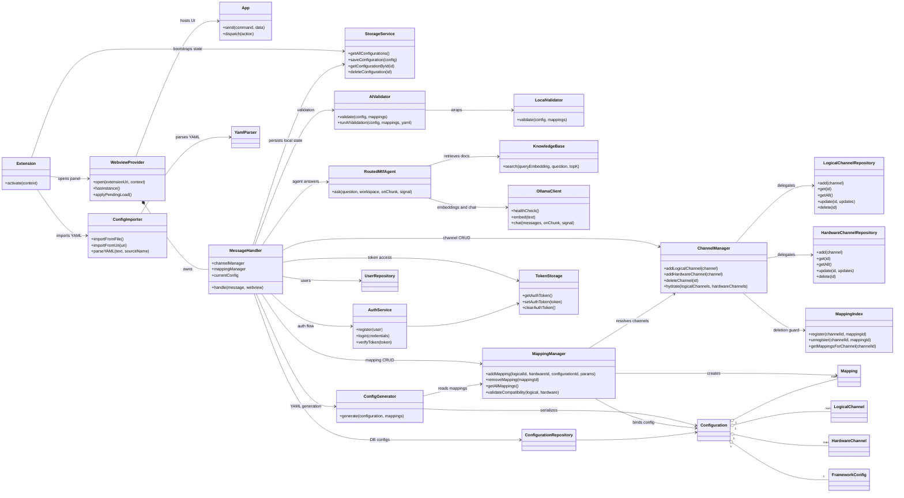
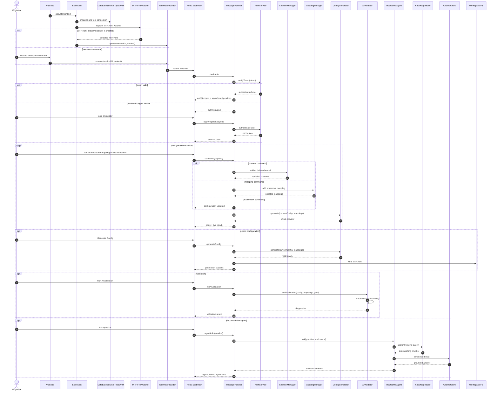
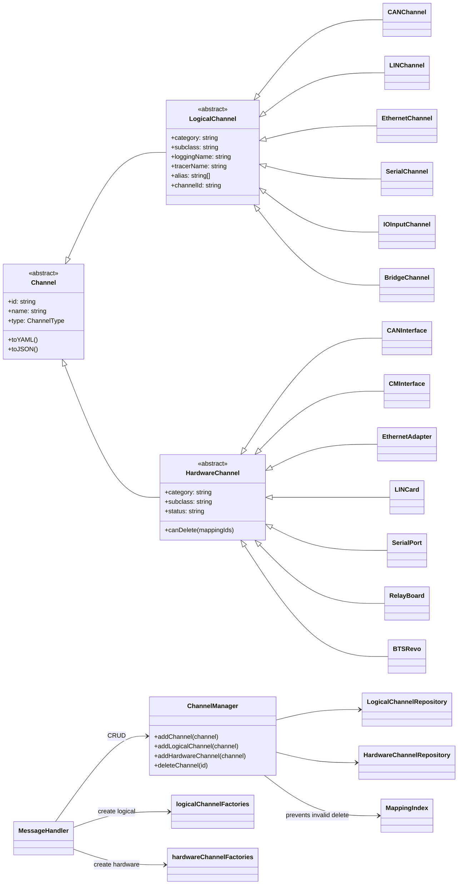
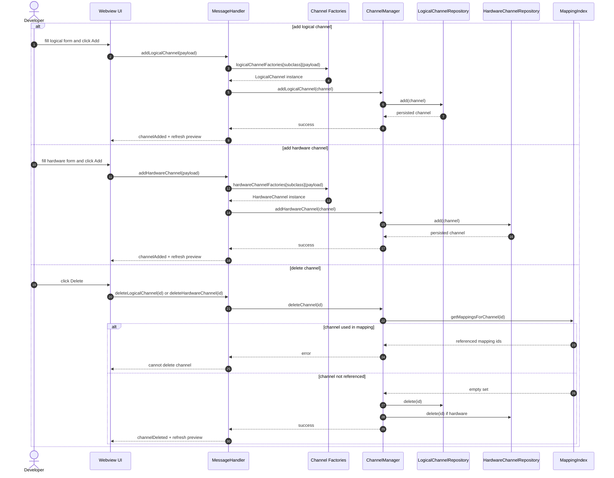
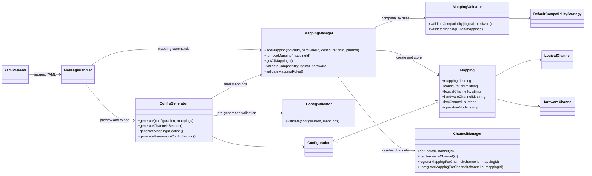
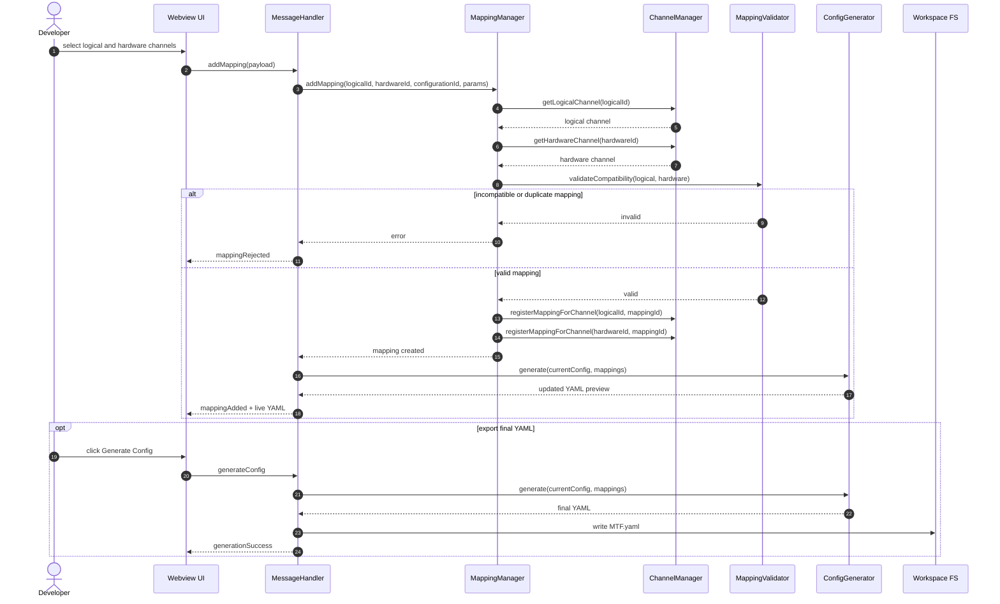
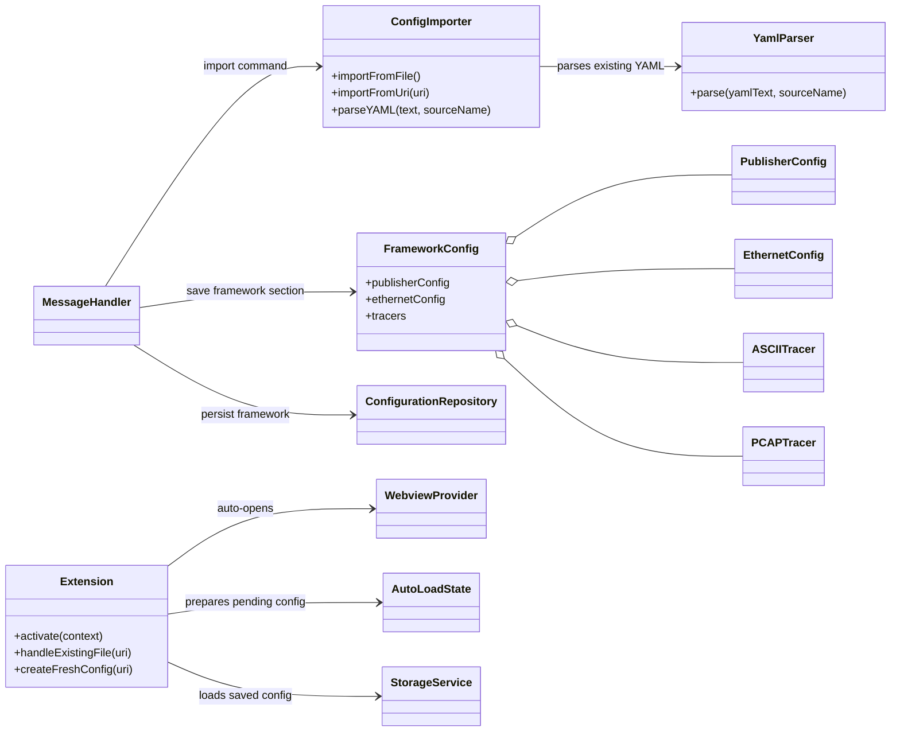
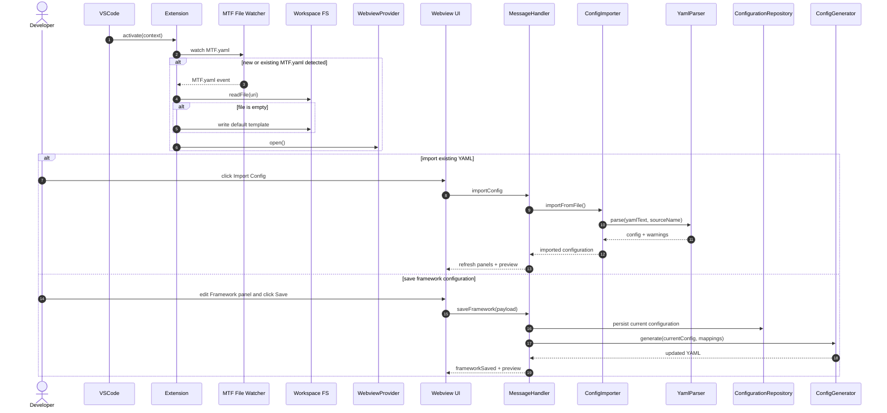
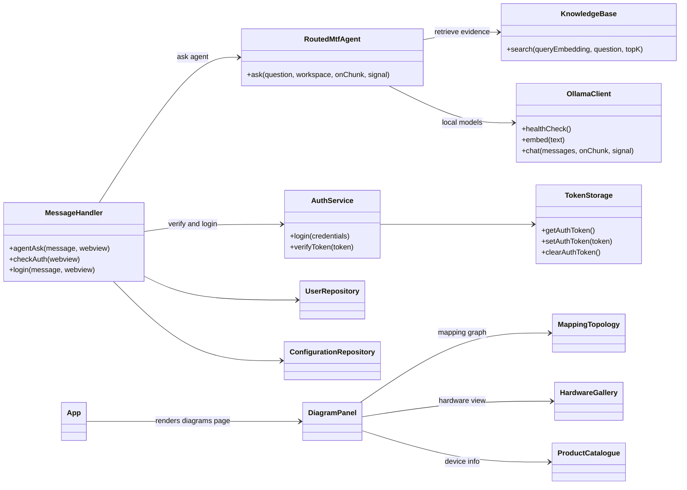
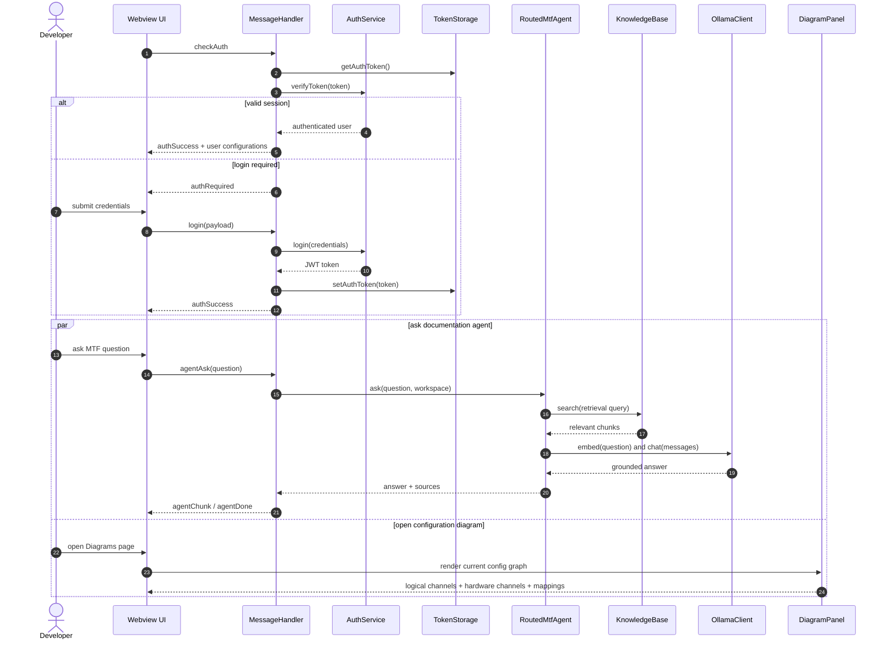

# UML Diagrams

This file consolidates the Mermaid sources for the report diagrams:

- global class diagram
- global sequence diagram
- Sprint 1 class and sequence diagrams
- Sprint 2 class and sequence diagrams
- Sprint 3 class and sequence diagrams
- Sprint 4 class and sequence diagrams

The sprint split follows the planning in the report text and is aligned with the current repository structure.

## Global Class Diagram

## Global Sequence Diagram

## Sprint 1 Class Diagram

## Sprint 1 Sequence Diagram

## Sprint 2 Class Diagram

## Sprint 2 Sequence Diagram

## Sprint 3 Class Diagram

## Sprint 3 Sequence Diagram

## Sprint 4 Class Diagram

## Sprint 4 Sequence Diagram

